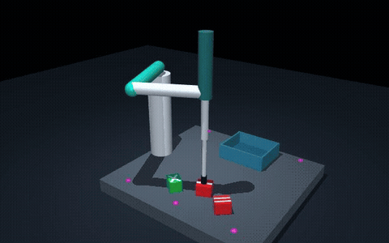

# PickLoop

**상품을 집어 옮기고, 실패를 감지해 복구하거나 보류하는 로봇 시스템.**

PyBrain AI AI Robot Engineer(S/W) 지원 검토용 프로젝트다. MuJoCo CPU 물리 시뮬레이션에서 RGB-D 관측 → 학습한 상품 임베딩 → 3D 상면 추정 → SCARA 계획·구동 → Modbus 흡착 → 운반·해제 → 영상과 별도 정답으로 배치 확인을 실행한다. 기존 ReachBench의 실제 pick/place 구현을 조사한 뒤, 품목 구분·실패 복구·장치 통신·운영 증거를 신규 범위로 구현했다.

[새 실물 사진 식별 · 등록 상품 정답과 미등록 오수락](https://pickloop-robot-ops.ykh13571.chatgpt.site/recognition) · [주문 상품 선택부터 배치·보류까지](https://pickloop-robot-ops.ykh13571.chatgpt.site/orders.html) · [주스 오인식 비교](docs/juice-gate.md) · [최신 물리 모델에서 운반 높이 직접 비교하기](docs/current-height.md)

## 로봇 피킹 작업 장면



첫 흡착 실패 뒤 다시 관측한 두 번째 시도다. 전체 영상에서 실패, 운반, 배치 확인 시점으로 이동할 수 있다. 실물 식료품 인식은 별도 매장 사진으로 평가했다. [전체 작업 영상과 원본 실행](https://pickloop-robot-ops.ykh13571.chatgpt.site/#work-scene) · [정답·오답·보류 사진](https://pickloop-robot-ops.ykh13571.chatgpt.site/evidence#photos)

### 매장 사진에서 상품 이름 확인

공개 매장 자료의 81개 상품을 등록했다. 기존 미등록 사진 2,656장의 공식 상품명과 예측을 확인하거나 Codespaces에서 `pickloop recognize 사진.jpg`로 직접 판별할 수 있다. [상품별 공개 데모](https://pickloop-robot-ops.ykh13571.chatgpt.site/evidence#photos) · [재현과 사진별 결과](docs/grocery-catalogue.md)

브라우저에서 **옆면 사진 판정 예시**를 누르면 손에 든 오렌지 주스의 성분 표시를 대조해 상품명을 판정한다. 같은 화면에서 내 사진을 선택할 수 있다. 등록한 스웨덴산 1 L 주스 3종의 포장을 비교하며, 바코드로 확인한 주문 규격을 별도로 표시한다. [실물 사진 판독](https://pickloop-robot-ops.ykh13571.chatgpt.site/recognition#read-package) · [옆면·앞면 사진의 최신 재시험](docs/experiments/side-panel-retry/)

### 지원자가 직접 수정한 복구 규칙

개발 seed 200에서 경로가 막힌 재시도에만 운반 높이를 0.40 m로 올리도록 수정했다. 경로 차단 작업은 변경 전후 19.690초에 완료했고, 보정 오차 작업은 두 번째 시도에서 완료하면서 26.935초에서 24.405초로 줄었다. 다섯 작업의 전후 기록을 PR에 담았다. 추가 개발 seed 201~209의 45쌍은 Codex가 별도로 재현했다. [본인 PR #1](https://github.com/sokldjs554/pickloop/pull/1) · [seed 200 실행 원문](docs/experiments/retry-height/) · [직무별 검증 화면](https://pickloop-robot-ops.ykh13571.chatgpt.site/evidence.html)

- [운영 데모](https://pickloop-robot-ops.ykh13571.chatgpt.site): 로그인 없이 링크로 접근 가능한 실제 기록 재생. 브라우저에서 새 물리 조건을 계산하는 화면이 아니다.
- [공고 대응표](docs/job-requirements-matrix.md) · [아키텍처](docs/architecture.md) · [기여 기록](docs/contributions.md)
- [4정책 비교 명세](docs/ablation-protocol.md) · PR #1 이전 동결 평가 원본: `runs/ablation-heldout/` (576회 완료, 원본·집계 공개)
- [과거 120회 결과](runs/final/summary.md) · [과거 집계 JSON](runs/final/metrics.json) · [과거 trial CSV](runs/final/trials.csv): 1회 기준/3회 복구 비교이며 복구 판단의 단독 효과를 증명하지 않는다.
- [학습·변환 평가](docs/vision-model.md) · [ROS2 실제 통신](docs/ros2-integration.md) · [모바일 확장](docs/mobile-extension.md)

Codex가 6축 팔의 장애물 우회, 재구성 지도에서 6.372 m 폐루프 주행, 빈 지도에서 두 구간 탐색, 48개 로봇 프로세스의 통로 경합을 검증했다. ROS 2 운반 중 취소 5건과 소프트웨어 PLC 재시험 원문도 공개했다. [직무별 실행 결과](https://pickloop-robot-ops.ykh13571.chatgpt.site/evidence.html#slam-route) · [25개 항목 전체 대조](docs/job-requirements-matrix.md)

## Mac에서도 브라우저로 실습하기

[GitHub Codespaces에서 PickLoop 열기](https://codespaces.new/sokldjs554/pickloop?ref=main)를 선택하세요. 처음 시작하면 Python과 시뮬레이션 패키지를 설치합니다. 준비가 끝나면 브라우저 터미널에서 아래 명령을 실행하세요.

```bash
python lab.py run my-current
```

마지막에 `기록 my-current/summary.json`이 출력되면 PR #1이 반영된 현재 정책으로 다섯 작업을 실행한 것입니다. [직접 실습 안내](docs/practice.md)에는 변경 전 커밋을 별도 경로에 열어 실험을 재현하는 방법이 있습니다. 자신의 가설과 판단은 [기록지](RECORD.md)에 남길 수 있습니다.

## 설치와 첫 실행

검증 환경: Linux x86_64, Python3.12, MuJoCo3.3.7, PyTorch2.7.1 CPU, EGL/Mesa 소프트웨어 렌더링, g++. 실물 로봇이나 GPU는 필요 없다. Linux와 다른 OS의 EGL/소켓/파일 잠금 호환성은 확인하지 않았다.

Ubuntu24.04 계열의 시스템 의존성 예:

```bash
sudo apt-get update
sudo apt-get install -y python3-venv libegl1 libgl1-mesa-dri libopengl0 g++ ffmpeg fonts-dejavu-core
python3 -m venv .venv
.venv/bin/pip install --extra-index-url https://download.pytorch.org/whl/cpu -r requirements-lock.txt
.venv/bin/pip install --no-deps -e .
export MUJOCO_GL=egl
export LIBGL_ALWAYS_SOFTWARE=1
.venv/bin/pytest -q
```

훈련된 소형 체크포인트와 생성된 텍스처는 포함되어 있다. Python 환경 lock은 실제 검증 환경에서 추출했다. `scripts/install.sh`도 같은 설치·검증을 실행한다.

```bash
# 정상 / 일시적 흡착 실패 복구 / 복구 불가 보류
.venv/bin/pickloop run --seed 7 --fault normal --out runs/local
.venv/bin/pickloop run --seed 7 --fault suction_once --out runs/local
.venv/bin/pickloop run --seed 7 --fault suction_permanent --out runs/local

# 실제 새 작업을 계산하는 로컬 운영 화면
.venv/bin/pickloop serve --host 127.0.0.1 --port 8000
# 브라우저: http://127.0.0.1:8000
```

로컬 화면의 실시간 모드에서는 주문 실행과 취소가 실제 API를 호출한다. 같은 job ID·내용의 완료 요청은 기존 결과를 반환한다. 한 셀은 한 작업만 실행한다. 중단된 작업은 자동 재실행하지 않고 HOLD_RECOVERY_REQUIRED로 조회된다.

## 재현 명령

```bash
# 현재 checkout의 정책으로 4정책 × 12조건 × 12 seed 새 평가
.venv/bin/python -m pickloop.experiment --out runs/reproduced-ablation

# 완료된 새 평가만 원본 result.json에서 다시 집계
.venv/bin/python -m pickloop.experiment --out runs/reproduced-ablation --aggregate

# 평가와 동일 조건으로 대표 재생을 기록하고 원평가와 대조
.venv/bin/python scripts/record_ablation.py runs/reproduced-ablation --out runs/reproduced-replay
.venv/bin/python scripts/export_ablation.py runs/reproduced-ablation runs/reproduced-replay --dest work/reproduced-web-data

# 과거 120회 기록 재집계: 새 4정책 실험과 합산하지 않음
.venv/bin/pickloop aggregate runs/final

# 모바일 이동→도킹→실제 피킹→셀 퇴장→다음 이동
.venv/bin/python scripts/run_mobile.py --help

# CNN 합성 데이터 훈련 및 검증; 아래 명령은 모델을 교체할 수 있으므로 별도 checkout 권장
.venv/bin/python scripts/train_vision.py --help

# C++ 실제 Modbus 클라이언트
mkdir -p work
g++ -std=c++17 -O2 -Wall -Wextra -Werror cpp/modbus_client.cpp -o work/modbus_client
.venv/bin/pytest tests/test_device.py -q

# 운영 화면 계약 검사
node tests/ui-contract.mjs
```

ROS2 Jazzy는 `ros2/Dockerfile`의 고정 공식 이미지로 빌드한다. [실행 명령과 DDS evidence](docs/ros2-integration.md)에 정상 Action, 취소, 중복 요청, 카메라·관절·clock 실제 수신 기록이 있다. Python 코어용 루트 Dockerfile도 제공하지만 이 세션에서 빌드 검증한 컨테이너는 ROS2 이미지이며 코어는 호스트의 고정 venv에서 검증했다.

## 결과의 의미

PR #1 이전 정책의 동결 비교는 개발 seed200..209와 분리한 seed3000..3011, 12개 조건, 아래 4정책의 576회다. `runs/ablation-heldout` 576회를 완료했다. 최대 3회 정책의 완료율은 단순 재시도 86/144(59.7%), 재관측만 103/144(71.5%), 재관측·재계획 113/144(78.5%)다. 자세한 조건별 결과와 TCP 응답 기한 영향은 [검증 결과](docs/submission-summary.md)에 공개했다. 소스·모델·조건 해시를 고정하고 모든 원본 결과를 집계한다. [조건·동결·군집 부트스트랩 명세](docs/ablation-protocol.md)를 따른다.

| 정책 | 최대 시도 | 실패 후 목표 | 운반·복귀 높이 |
|---|---:|---|---|
| baseline | 1 | 재시도 없음 | 0.30m |
| naive | 3 | 마지막 유효 목표 재사용 | 0.30m |
| reobserve | 3 | RGB-D 재관측 | 0.30m |
| recovery | 3 | RGB-D 재관측 | 재시도 때 0.40m |

세 재시도 정책은 sim 60초/wall 90초의 같은 상한과 안전 검사를 쓴다. naive도 목표를 얻지 못한 상태라면 관측을 재시도하고, 압력으로 하중을 확인하면 어느 정책이든 재접근 대신 운반을 이어간다. `naive→reobserve`는 목표 갱신, `reobserve→recovery`는 경로 높이 변경을 비교한다. 이 특정 정책들에 한정한 절제 실험이며 모든 단순 재시도보다 우수하다는 주장은 아니다.

과거 `runs/final`의 seed1000..1004·120회는 보존한다. 1회/3회라는 시도 예산과 정책이 함께 달라졌으므로 그 차이를 복구 판단의 인과 효과로 해석하지 않는다. 과거 결과와 새 576회는 조건 생성·소스가 달라 통계를 합치지 않는다. 새 조건 JSON의 장애는 정책·시도와 독립적인 절대 sim 시간표이고, `condition=None`인 과거·기본 CLI 시나리오는 첫 관측/첫 시도 기반 장애다.

작업 완료율, 첫 시도 lift 성공률과 첫 시도 최종 완료율, 복구율, 잘못된 배치, 낙하, 금지 충돌, 보류, 재시도, 시간, 처리량을 구분한다. 실패 시간도 처리량 분모에 포함한다. simulator throughput과 measured CPU wall throughput은 별개이며 실물 현장 생산성·ROI를 주장하지 않는다. 장애 시간표·지표 정의는 [아키텍처](docs/architecture.md)와 [비교 명세](docs/ablation-protocol.md)에 공개했다. 종료 시 신선한 장치 응답으로 빈 상태가 확정된 경우에만 밸브 OFF를 확인하고, 부착·하중 추정·출력 불확실성은 유지/보류한다. [정지·출력 정책](docs/hold-policy.md)은 HELD와 밸브 ON을 같은 의미로 취급하지 않는다.

합성 평가에서는 직접 생성한 두 가지 붉은 줄무늬 상자와 합성 미등록 패턴으로 검증했다. 최종 합성 평가에서 known240/240, 지정 unknown120/120을 구분했지만, 이 수치는 실제 상품·임의의 unknown 전반에 대한 성능이 아니다. 초기 확인한 평가 분할은 개발 자료로 재분류했고, 모델 동결 후 새로운 seed30000대에서 최종 평가했다.

## 코드 읽기 순서

`types.py` → `geometry.py` → `perception.py`/`vision_model.py` → `simulation.py` → `device.py`와 `cpp/modbus_client.cpp` → `engine.py` → `journal.py`/`server.py` → `evaluation.py`. 정책 비교는 `conditions.py` → `experiment.py`와 [절제 실험 명세](docs/ablation-protocol.md)를 이어서 읽고, 관련 회귀 테스트·각 실행의 `events.jsonl`을 대조한다. 자세한 질문·설계 판단은 [면접 가이드](docs/interview-guide.md)에 있다.

## 확인된 범위와 남은 공백

운영 화면은 4정책 설명·동일 조건 비교·주요 지표·조건별 원본·시도별 실패 이력과 ROS2/C++/모바일 증거 링크를 제공한다. UNKNOWN의 진단점수는 등록 품목 간 softmax이며 보정된 확률이 아니다. 최종 평가 수치는 배치 완료와 원본 집계 후에만 제시한다.

실제 물리 시뮬레이션, CPU 모델 훈련·추론·TorchScript, TCP Modbus/C++, ROS2 Action/DDS, 동일 작업 엔진을 호출하는 모바일 운동학 시나리오를 실행했다. 웹 데모는 해당 기록을 재생한다. GitHub Actions에서 코어 검증과 Codespaces 실습을 실행했다. [검증 기록](https://github.com/sokldjs554/pickloop/actions).

실물 주스팩의 인쇄 무늬와 색을 확인해 기존과 동일한 매장 사진에서 등록품 정답을 3/54에서 44/54로 높였다. 다른 포장 727장과 과일·채소 1,704장의 오수락은 각각 0건이었다. 보류한 등록품 10장과 중간 모델의 실패도 함께 공개한다. [사진 한 장 판별·전체 결과](docs/carton-recognition.md) · [기존 실험](docs/real-photo-evaluation.md)

| 주요업무 | 추가 실행 근거 |
|---|---|
| 박스 인식과 로봇 배치 | 모의 RGB-D 상자 32개를 추정하고 8건에서 영상·물리 배치를 검증했다. [결과](docs/bin-perception.md) |
| 손목 카메라 보정 | 공개 USDA 실측 88쌍 중 22쌍을 따로 두고 픽셀 예측 오차를 측정했다. [좌표계와 결과](docs/hand-eye.md) |
| 모바일 SLAM | 시뮬레이션 라이다·바퀴 기록으로 세 경로의 점유 지도를 만들고 재방문 보정 효과를 측정했다. [지도와 오차](docs/lidar-slam.md) |
| 도킹·다중 로봇 | 두 모의 AMR가 충전기를 공유한다. 정상 인계와 네 가지 전기 고장 시 보류를 확인했다. [전류·점유 기록](docs/dock-charging.md) |
| 설비 연동 | 기존 C++ 클라이언트와 독립 S7 소프트웨어 PLC를 TCP로 연결해 13단계를 검증했다. [PLC 프로그램과 패킷 기록](docs/plc-interop.md) |

실물 로봇 배포, 흡착 누설·안전 회로, 현장 주행과 실제 충전기·PLC 시운전은 남아 있다. 모바일 주행과 고정 셀 시뮬레이션은 도킹 확인 후 연결한다. [실물 인수시험 절차](docs/hardware-acceptance.md)

사용자가 확인한 PCB 경험은 PADS·ATmega128의 회로 설계/부품 배치/배선과 도구 검증이다. KiCAD나 실물 측정 경험을 추정하지 않는다. [확인 내용과 지원서 표현](docs/pcb-experience.md)을 참고한다. 지원자가 직접 수정한 복구 규칙과 그 전후 실행은 [PR #1](https://github.com/sokldjs554/pickloop/pull/1)에 기록했고, AI가 수행한 학습·독립 검증은 [기여 기록](docs/contributions.md)에 표시했다.
