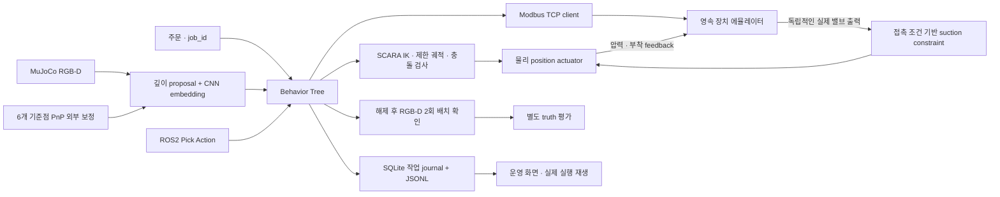

# PickLoop 아키텍처와 검증 경계

## 실행 흐름

`simulation.py`는 물리 환경과 센서·밸브의 plant adapter다. `perception.py`는 RGB/깊이/K/외부 보정만 받으며 시뮬레이터를 import하지 않는다. `engine.py`가 목표 위치를 정할 때 사용하는 것은 인식 결과뿐이다. 객체 정답은 시뮬레이터 내부 접촉/흡착 계산과 마지막 독립 평가에서만 사용한다.

## 모듈 계약

| 모듈 | 입력 / 출력 | 책임과 실패 |
|---|---|---|
| geometry | pixel/K/depth/T ↔ base XYZ; joint targets → quintic | m/rad/s, 도달 불가·관절 범위 거부 |
| simulation | actuator 목표/실제 장치 출력 → 적분 상태/RGB-D/pressure | 5ms 적분, 물체 질량·중력·접촉·weld, 동적 충돌 감시 |
| perception | timestamped RGB-D → SKU/UNKNOWN, 상면 XYZ/bbox/불확실성 | 깊이 높이 ROI와 연결 성분은 직접 구현, CNN은 PyTorch로 실제 훈련 |
| device | 실제 TCP FC03/16 ↔ command ID/ack/valve/pressure | 별도 영속 intent/result, 중복 억제, 미확인 상태 보류 |
| engine | 주문/관측/장치 feedback → 완료/HELD/CANCELLED | py_trees Sequence+bounded Recovery decorator, baseline 1회/나머지 최대 3회 |
| conditions/experiment | 사전 조건 JSON·4정책 → 고정 manifest/짝 평가/집계 | 절대 sim 시간 외란, 해시 일치 검사, seed 군집 비교 |
| journal | job ID+payload → 영속 상태/결과 | 동일 ID 다른 payload 거부, 프로세스 재시작 중단 작업 fencing |
| server | HTTP 요청/취소 → 동일 engine | 단일 runner file lease, SQLite 재시작 복원, 다른 origin의 쓰기 거부 |
| ROS2 bridge | 실제 DDS Action → HTTP engine, feedback/telemetry | 로컬 Jazzy 컨테이너에서 실제 검증. ros2_control 자체 구현은 아님 |
| mobile | encoder/landmark/LiDAR → EKF/A*/wheel commands | 알려진 지도 운동학 시뮬레이션, 도킹 gate 후 같은 engine 호출 |

## 좌표·시간

- `base`는 고정 셀 우수계: x 오른쪽, y 뒤쪽, z 위. SI 단위 m/rad/s.
- `camera_optical`: x 오른쪽, y 아래, z 앞. RGB/깊이 480×480; 깊이는 광축 방향 거리(m).
- `T_base_camera`는 camera→base 4×4; 6개 마커의 실제 이미지 중심과 알려진 설치 좌표로 `solvePnP`. 매 run `calibration.json`의 대응점·행렬·재투영 RMS를 저장한다. 카메라 위치를 MuJoCo cam_xpos에서 제어기로 복사하지 않는다.
- 피킹 셀은 고정 카메라의 외부 보정을 사용한다. 별도 [이동 손목 AX=XB 시험](hand-eye.md)에서는 공개 실측 사진과 로봇 자세를 사용했다. 실제 피킹 셀의 렌즈와 깊이 스케일 교정은 미측정이다.
- 관측에는 `sim_time`, 수신 monotonic ns, `observation_id`, calibration ID가 있다. 관측 나이 350ms 초과, wall 전달 나이 5s 초과는 거부한다.
- frame의 두 영상·관절·TCP·압력은 물리 step을 전진시키지 않고 같은 시점에 캡처한다. 인식 overlay는 같은 sim timestamp일 때만 붙인다. 로그는 그 event ID와 연결된다.
- 프로그램 wall 시간은 CPU 렌더링·추론·TCP·로그 비용을 포함한다. sim 시간과 동일하지 않다. 네트워크 timeout은 wall 기준, 운동 deadline은 sim 기준이다.

## 동작·충돌·흡착

4축 SCARA는 L1=0.32m, L2=0.28m이며 각도/수직 범위는 `geometry.py`에 명시한다. 계획 속도 상한은 [0.9,0.9,0.22,1.2], 가속도 [1.5,1.5,0.35,2.0] (회전축 rad 단위, 수직축 m 단위). 정상/낙하 복구의 실제 측정 회귀 테스트는 회전 1.2rad/s·3rad/s², 수직 0.8m/s² 이내를 검사한다. 접촉 충격은 별도 상태로 기록하며 인증된 safety limit라는 주장은 하지 않는다.

궤적은 qpos 순간 이동이 아니라 position actuator 입력 후 MuJoCo 적분으로 실행한다. 25ms 이하 샘플 간격의 충돌 사전 검사와 각 5ms 물리 step의 실제 접촉 감시가 있다. 사전 검사에는 측량된 고정 설비 지도와 일반 상품 bounding box를 사용하며, 동적 상품의 실제 좌표는 probe에서 지운다. 잡은 물체는 품목 카탈로그의 상자 envelope로 검사한다. 밀집 clutter의 모든 물체 간 충돌을 이미지에서 재구성하는 플래너는 아니다. 연속 충돌 검사의 수학적 보장도 없다.

흡착은 평평한 상면, 컵 반경12mm, 상면 안쪽 여유, 4.5mm 이내 접근, 법선12° 이내 정렬에서만 weld를 활성화한다. 압력 -55kPa, 이론 흡착력 약24.9N과 제약력 한계를 사용한다. 컵과 상자 사이의 rigid contact는 제외해 유연한 컵을 단순화하며, 상자는 나머지 환경과 실제 충돌한다. 압력은 장치 write 성공에서 만들지 않고 물리 모델에서 계산해 Modbus feedback으로 보낸다. 카탈로그 질량80g 중력 feed-forward가 있다. 실제 누설·다공성 포장·흡착 지연·컵 변형·진공 저장 용량은 모델링하지 않았다.

밸브 출력은 RPC 응답 여부와 독립적으로 plant에 적용된다. 명령은 실행됐는데 ACK와 상태 응답이 모두 사라지는 경우에도 물리는 흡착하고 작업은 DEVICE_UNCERTAIN으로 보류한다. 새 ID를 발급하여 재실행하지 않는다.

## 작업·복구·취소

BT: Observe→Plan→Approach→Seal→Lift→Transport→Place→Release→Verify. baseline은 1회, naive/reobserve/recovery는 최대 3회이며 sim 60초/wall 90초 상한을 공유한다. naive는 마지막 유효 파지 목표와 0.30m 경로를 반복하고, 목표가 없을 때만 품목 위치를 다시 얻는다. 재시도 중에도 새 관측의 신선도·압력·충돌 검사를 유지한다. reobserve는 매 시도 RGB-D 목표를 갱신하되 경로 높이는 같고, recovery는 여기에 재시도 운반·복귀 높이 0.40m를 더한다. 압력으로 잡은 하중을 확인한 경우 세 정책 모두 재관측·접근·흡착을 건너뛰고 운반을 이어간다. 불명확한 장치 실행, 취소, 시간 초과, 실제 충돌은 재시도하지 않는다. 이는 정해진 높이와 관측 갱신의 비교이며 후보 파지 최적화·능동 시점 변경·일반 경로 탐색은 아니다.

정상 정지/복구는 이전 명령 위치·속도에서 연속 감속한다. 종료의 `STOP_REPORT`, 재시도 소진의 `RETRY_EXHAUSTED`, 밸브 결정의 `HOLD_POLICY`는 별도 사건이다. 멈춘 물리와 단일 제어 소유권 아래 새 TCP 상태를 읽고, ACK/max ID·오류·부착 해제·절대 압력 <10kPa가 모두 빈 상태를 확인하며 불확실성/하중 추정이 없을 때만 OFF를 허용한다. 부착 하중·불확실한 출력은 자동 해제하지 않는다. 복구의 빈 그리퍼 초기화에도 같은 helper를 적용하고 확인 불가면 보류한다. `RETAIN`은 쓰기를 하지 않았다는 뜻이며 ON 보장이 아니고, `OFF_UNCONFIRMED`는 OFF가 이미 적용되었을 수 있는 불확실성이다. [출력 정책의 race·freshness·실물 interlock 한계](hold-policy.md)를 따른다. 충돌 중 정지는 contact를 latch하고 최종 stop report를 남긴다. 물리 정지를 확인하지 못하면 이를 로그에 보존하며, 이 소프트웨어가 독립 비상정지 회로를 대체하지 않는다.

SQLite는 작업 ID/내용과 terminal 결과를 보존한다. 동일 완료 요청은 기존 결과를 반환한다. 시작 시 runner lease를 얻은 프로세스만 중단 작업을 HOLD_RECOVERY_REQUIRED로 바꾸며 GET으로 조회 가능하다. 시뮬레이터 프로세스가 죽은 뒤 물리 상태를 자동 복원/재실행하지 않는다. 실물 재연결에서는 장치·하중을 사람이 재확인해야 한다.

## 판정과 지표 경계

운영 성공: 올바른 SKU가 박스 안에서 2회 정지 관측되고 밸브/압력/부착 상태로 해제를 확인. 별도 evaluator가 실제 품목, bin 내부 위치, 속도<0.02m/s, 손에서 분리를 확인해야 최종 완료다.

`drops`: 강제/과부하 흡착 상실 또는 물체 밑 지지면과 40mm 넘게 떨어진 상태에서 해제한 사건 수. 실제 충전/현장 파손률을 뜻하지 않는다. `collisions`: 인접 링크 접촉과 정상 지지 접촉을 제외한 로봇/파지 물체의 1mm 초과 침투 접촉 episode 수. 모든 물체 사이의 모든 접촉 수가 아니다.

새 4정책 평가에는 `conditions.make_condition`의 고정 JSON을 전달한다. 배치·회전·깊이 잡음·지속/일시 좌표 편차·흡착 허용 오차/압력/힘·질량/마찰·장애물 높이·외란 시간표를 개발/heldout 분포에서 정하고 `condition_id`와 해시를 저장한다. 가림 ROI·깊이 결측·일시 보정 편차는 sensor release 시간, 흡착 공급 중단과 drop은 outage window, 통신은 communication window에 따라 절대 sim 시각으로 결정된다. 정책 이름·시도 수·관측 호출 수로 외란 해소 시점을 바꾸지 않는다. 깊이 잡음도 seed+20ms 구간에 묶어 녹화 호출의 난수 소비 영향을 막는다. 정책의 동작 시간이 달라 같은 외란 시간표의 다른 순간을 관측하는 것은 정책과 환경의 상호작용으로 포함한다.

`condition=None`인 과거 `runs/final`과 기본 CLI fault는 첫 관측/첫 시도 장애·고정 28mm 일시 보정 편차 등의 기존 방식이다. 이를 새 조건의 정책 독립 외란으로 설명하거나 통계에 합치지 않는다. 새 보정 조건에도 지속 편차가 남고 일시 편차만 정해진 때 해소되며, 온라인 보정 drift 추정·카메라 이동 복구를 구현한 것은 아니다. 가림은 이미지 ROI 차폐 모사이고 실제 가림 물체 동역학이 아니다. suction 공급/힘 제한에 의한 강제 분리는 모두 공중 낙하를 뜻하지 않는다.

과거 1회 기준/3회 복구 120회는 시도 예산 차이를 포함하므로 복구 판단의 인과 증거가 아니다. 현재 `runs/ablation-heldout`은 12 seed×12조건×4정책 576회를 완료했으며 원본과 집계를 공개했다. 모든 원본·짝 조건·소스/모델 해시를 검사하고 seed 군집 bootstrap으로 차이를 추정한다. [실험 명세와 재현](ablation-protocol.md)을 따르며 작은 합성 분포의 결과를 자연 발생 장애·현장 성능으로 일반화하지 않는다.
