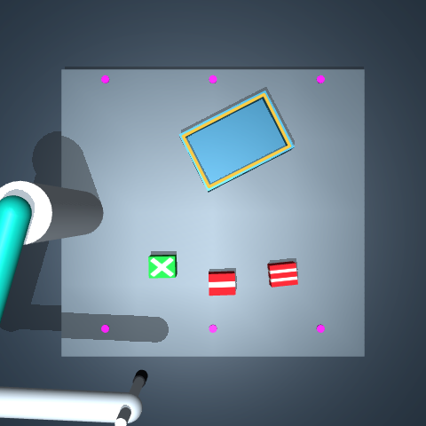

# RGB-D로 찾은 목적지 박스에 상품 놓기

고정 카메라로 파란 개방형 박스의 중심, 회전각, 개구부 안쪽 두 변, 바닥·테두리 높이를 측정했다. 잡을 상품은 기존 SKU 인식기로 찾는다. 이 실험에서 새로 추정하는 대상은 상품을 담을 **목적지 박스**다. 무작위 배치 32개에서 인식 오차를 측정했고, 그중 처음 8개에서는 실제 MuJoCo 작업 엔진이 카메라로 찾은 위치까지 상품을 운반하고 놓았다. [집계 JSON](../runs/bin-perception/metrics.json) · [32개 원본 측정값](../runs/bin-perception/perception-trials.json)



## 관측에서 해제 목표까지

1. 480×480 RGB, 미터 단위 깊이, 카메라 내부 파라미터, 6점 PnP로 구한 카메라→로봇 변환을 입력받는다. 파란색 후보 영역을 찾고 깊이 픽셀을 로봇 기준 좌표로 역투영한다. [검출기](../src/pickloop/bin_perception.py)
2. 상단 점의 최소 면적 사각형으로 긴 변의 방향을 추정한다. 네 변 각각에서 깊이로 지지되는 구간과 내측 경계를 측정한다. 안쪽의 다른 높이에 평평한 바닥이 있어야 한다. 서로 맞닿은 두 박스가 하나의 색 영역으로 합쳐져도 내부에 테두리 높이의 칸막이가 보이면 보류한다.
3. 로봇은 측정된 중심 위로 이동해 측정 바닥보다 63 mm 높은 위치에서 해제한다. 상품 높이 50 mm와 해제 여유 13 mm를 합한 값이다. 상품이 들어갈 여유는 64×52 mm 카탈로그 바닥면의 반대각선과 3 mm 마진으로 검사한다. 해제·후퇴 후 두 번의 새 RGB-D 관측으로 박스와 주문 SKU를 각각 다시 찾아 내부 위치, 높이와 정지를 확인한다. [작업 엔진](../src/pickloop/engine.py)
4. 별도 물리 판정은 실제 상품의 여덟 모서리가 회전된 박스 개구부 안에 있는지, 최저점이 바닥에서 4 mm 이내인지, 속도가 0.02 m/s 미만인지, 흡착이 해제되었는지 확인한다. 평가용 박스 자세와 MuJoCo 물체 ID는 검출기에 전달하지 않는다. 경로의 충돌 사전 검사는 기존 시뮬레이터 고정 설비 지도를 사용한다. [장면 생성 및 독립 판정](../src/pickloop/simulation.py)

## 32개 장면의 인식 오차

Seed 74100–74131에서 중심 x(215–445 mm), y(135–180 mm), 안쪽 긴 변(170–220 mm), 짧은 변(100–145 mm), yaw(−60°–60°), 바닥에서 테두리까지 깊이(43–81 mm)를 각각 독립적으로 균일 추출했다. 바닥의 실제 높이는 72 mm다. 렌더링한 깊이에 표준편차 0.65 mm 가우시안 잡음과 독립 픽셀 결측 2.5%를 추가했다. 32개 모두 검출됐다. 중심 오차는 평면 유클리드 거리이며 yaw는 사각형 대칭을 반영해 180° 주기로 비교했다.

| 오차 | 평균 | 95백분위 | 최대 |
|---|---:|---:|---:|
| 중심 XY (mm) | 0.216 | 0.329 | 0.423 |
| 긴 변 (mm) | 0.186 | 0.451 | 0.924 |
| 짧은 변 (mm) | 0.205 | 0.421 | 0.722 |
| yaw (°) | 0.034 | 0.095 | 0.346 |
| 바닥 높이 (mm) | 0.426 | 0.492 | 0.507 |
| 바닥–테두리 깊이 (mm) | 0.031 | 0.068 | 0.097 |

첫 장면의 [원본 RGB](../runs/bin-perception/example/rgb.png), [잡음·결측을 포함한 깊이와 보정 행렬](../runs/bin-perception/example/depth-calibration.npz), [추정·정답 쌍](../runs/bin-perception/example/observation.json)을 제공한다. 고정된 색·재질과 수직 카메라 덕분에 여러 픽셀에서 같은 평면과 변을 측정할 수 있다. 수치는 이 합성 분포에 한정한다.

## 물리 작업과 보류 결과

물리 작업은 같은 8개 배치(seed 74100–74107)에서 A/B SKU를 번갈아 주문하고 각 작업을 한 번만 시도했다. 이 단계는 기본 렌더러 깊이를 사용했다. 8/8회가 카메라와 별도 물리 판정을 모두 통과했다. 잘못된 품목 배치, 낙하, 금지 충돌은 각 0회였다. 예를 들어 seed 74106의 목적지 중심은 (307.5, 160.5) mm다. OBSERVE의 추정값과 PLACE의 실제 해제 명령을 관측 ID로 연결할 수 있다. [작업 결과](../runs/bin-perception/jobs/single-74106/result.json) · [작업 사건 로그](../runs/bin-perception/jobs/single-74106/events.jsonl)

| 제어 사례 | 관측한 형상 | 결과 |
|---|---|---|
| [박스 없음](../runs/bin-perception/jobs/missing/events.jsonl) | 지지되는 개구부 0개 | OBSERVE에서 `BIN_NOT_FOUND`, HELD |
| [분리된 두 박스](../runs/bin-perception/jobs/ambiguous/events.jsonl) | 지지되는 개구부 2개 | OBSERVE에서 `BIN_AMBIGUOUS`, HELD |
| [맞닿은 두 박스](../runs/bin-perception/jobs/touching/events.jsonl) | 하나의 색 영역 가운데에 칸막이 | OBSERVE에서 `BIN_OPENING_OBSTRUCTED`, HELD |
| [좁은 박스](../runs/bin-perception/jobs/undersized/events.jsonl) | 안쪽 폭 79 mm, 안전 여유 부족 | OBSERVE에서 `BIN_TOO_SMALL`, HELD |

보류 사례 4건에는 최대 3회 시도하는 복구 정책을 적용했다. 네 건 모두 첫 OBSERVE에서 상품 접근·흡착 전에 멈췄다. 이 범위는 정지 상태의 수평 직사각형 박스, 정해진 파란 재질, 배치 전 비어 있는 목적지, 알려진 크기의 상품을 전제로 한다. 다양한 색·투명 포장·임의 상품 크기, 이동 중인 박스 추적, 실물 센서의 오차와 강한 가림에서의 성능은 평가하지 않았다.

## 재현

기본 CLI와 기존 120·576회 기록은 원래의 고정 목적지를 사용한다. 아래 스크립트는 `run_job(..., bin_layout=...)`로 새 모드를 선택하고, 검출기·장면·제어기·모델·평가 스크립트의 SHA-256을 결과에 저장한다. [평가 스크립트](../scripts/run_bin_evaluation.py) · [렌더링/작업 회귀 검사](../tests/test_bin_perception.py)

```bash
OPENBLAS_NUM_THREADS=1 LIBGL_ALWAYS_SOFTWARE=1 python scripts/run_bin_evaluation.py --out runs/bin-perception-reproduced
python -m pytest -q tests/test_bin_perception.py
```
