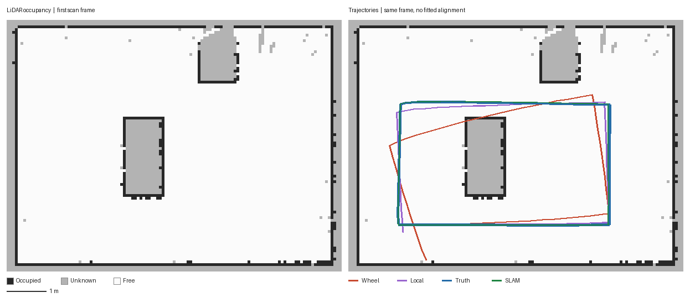

# 36빔 LiDAR로 지도를 만들고 재방문을 검증한 실험

같은 방을 약 16.7 m씩 세 번 돌았다. 바퀴 엔코더만 적분하면 위치 RMSE가 0.616–0.664 m였고, 인접한 LiDAR 스캔을 정합하면 0.143–0.168 m로 줄었다. 출발 구역을 다시 관측한 스캔까지 연결해 전체 궤적을 보정하자 RMSE는 0.012–0.022 m였다. 모두 기존 차동구동 **운동학 시뮬레이터에서 측정한 값**이다.



왼쪽 그림의 검정은 레이의 끝점으로 판단한 벽이나 장애물 표면, 흰색은 레이가 통과한 공간, 회색은 관측 근거가 부족한 셀이다. 위쪽 장애물 뒷면처럼 가려진 곳에는 회색이 남는다. 오른쪽 그림에서 빨강은 바퀴 오도메트리, 보라는 인접 스캔만 사용한 궤적, 초록은 루프 보정 후, 파랑은 평가용 기준 궤적이다. 두 그림은 시드 7의 센서 기록에서 생성했다.

## 주행과 지도 작성

기존 도킹·피킹 임무는 사전 지도, A* 경로계획, 위치를 아는 랜드마크에 대한 EKF로 주행한다. 이번 실험에서는 같은 주행기와 센서로 별도의 순환 경로를 달려 관측을 수집했다. 주행기는 시험 경로를 따라가는 데 사전 지도를 쓴다. 오프라인 SLAM 함수 `estimate(odometry, scans)`에는 **바퀴로 적분한 자세와 LiDAR 거리 36개**만 전달한다. 첫 스캔을 원점으로 정하고 매 시점의 자세와 지도 셀을 추정한다. 평가기는 계산이 끝난 뒤에 시뮬레이터의 실제 자세 및 벽 배치를 읽는다. [기존 모바일 임무](mobile-extension.md) · [SLAM 구현](../src/pickloop/lidar_slam.py) · [수집·평가 코드](../scripts/run_lidar_slam.py)

1. 0.04초 간격으로 바퀴 엔코더와 360° LiDAR를 읽었다. 센서는 매 스텝의 이동 **전**에 스캔하고 엔코더는 해당 이동 구간의 속도를 보고하므로, 각 스캔을 바로 전 구간까지 적분한 자세와 짝지었다. 0.30 m 이동 또는 0.34 rad 회전하면 키프레임을 저장했다.
2. 인접한 세 빔이 같은 표면을 관측한 구간에서 짧은 선분을 얻었다. 엔코더 변위를 초깃값으로 삼아 현재 스캔의 점에서 이전 스캔의 선분까지 수직거리를 줄이는 ICP를 수행했다. 양방향 정합의 겹침, 잔차와 서로 다른 방향의 표면 관측을 확인한 뒤 상대변위를 바퀴 추정과 결합했다. 인접 정합을 실행한 결과가 표의 ‘인접 스캔’이다.
3. 바퀴 누적 경로상 5 m 이상 떨어지고 추정 자세가 0.75 m, 0.8 rad 이내로 가까워진 과거 키프레임을 재방문 후보로 삼았다. 양방향 유효 점 비율이 64% 이상이고 수직 잔차 RMS가 0.031 m 미만인 경우 등 기하 검사를 통과한 쌍을 추가했다. 첫 자세를 고정한 SE(2) 자세 그래프에서 인접 변위와 재방문 상대변위의 오차를 함께 줄였다. 마지막 위치가 출발점과 같다는 조건은 넣지 않았다.
4. 보정한 자세에서 각 레이를 따라 0.07 m 격자의 자유공간과 점유 근거를 누적했다. 센서 최대거리 8 m에 근접한 표본은 자유공간으로만 기록했다.

## 기록된 결과

위치 RMSE는 키프레임마다 동일 시각의 기준 자세와의 평면거리 제곱을 평균한 뒤 제곱근을 취한 값이다. 세 방법은 같은 키프레임과 같은 시작 좌표계를 사용한다. 평가할 때 궤적 전체를 기준 궤적에 맞춰 회전·이동하지 않았다.

| 시드 | 키프레임 | 바퀴만 RMSE | 인접 스캔 RMSE | 루프 보정 RMSE | 루프 보정 후 최종 위치 오차 | 승인된 재방문 제약 |
| ---: | ---: | ---: | ---: | ---: | ---: | ---: |
| 7 | 69 | 0.658 m | 0.143 m | 0.022 m | 0.0007 m | 2 |
| 19 | 70 | 0.616 m | 0.168 m | 0.012 m | 0.0013 m | 2 |
| 41 | 70 | 0.664 m | 0.150 m | 0.014 m | 0.0050 m | 1 |

**재방문 검증.** 세 주행에서 출발 구역을 한 번씩 다시 통과하며 총 5쌍의 키프레임을 연결했다. 각 쌍에서 스캔이 추정한 상대변위와 기준 상대변위의 차이는 위치 최대 0.0034 m, 각도 최대 0.0024 rad였다. 시드 7에서 키프레임 0과 68의 재방문은 양방향 겹침 83.3%, 점-선 잔차 RMS 0.0060 m로 승인됐다. 결과 JSON에 각 쌍과 오차를 기록했다. [세 시드의 수치와 재방문 목록](../runs/lidar-slam/summary.json)

**반례.** 재방문 전 35개 키프레임만 재생했을 때 세 시드 모두 후보가 0개였다. 이와 별도로 약 6.15 m 떨어진 두 장소에 상대변위가 0이라고 강제로 제안해 거리 기반 후보 선별을 건너뛰었다. 스캔 검증기가 세 번 모두 이 제안을 거절했다. 회귀 테스트에서는 반대로 실제 재방문 위치에 일부러 틀린 엔코더 초깃값을 주고 스캔 정합이 올바른 변위를 복원하는지도 확인한다. [회귀 테스트](../tests/test_lidar_slam.py)

**지도 품질.** 실제 방 외곽과 두 장애물 표면을 0.02 m 이내 간격으로 샘플링했다. 세 지도에서 점유 셀 중심의 100%가 가장 가까운 기준 표면으로부터 0.14 m 이내였다. 반대로 전체 기준 표면의 97.95–98.11%가 점유 셀 중심 0.14 m 이내에 들었다. 후자의 분모에는 보이지 않는 벽 뒤쪽 표면도 들어간다.

세 시드는 같은 직사각형 방, 같은 장애물 배치와 같은 경로에 센서 잡음을 다르게 적용한 반복이다. 이 결과의 검증 범위는 해당 배치에서의 오프라인 지도 작성과 재방문 보정까지다. 이동 중인 물체, 대칭적인 복도, 큰 초기 위치 오차, 실물 센서나 바닥 접촉은 별도의 시험 대상이다.

## 재현

저장소 루트에서 프로젝트 의존성을 설치한 Python으로 실행한다. 출력 디렉터리를 지정하면 보관된 예시와 나란히 비교할 수 있다.

```bash
PYTHONPATH=src OPENBLAS_NUM_THREADS=1 python scripts/run_lidar_slam.py --seeds 7 19 41 --out-dir /tmp/pickloop-lidar-slam
PYTHONPATH=src python -m pytest tests/test_lidar_slam.py -q
```

`summary.json`에는 시드별 자세·지도 지표, 참조 코드와 설정의 SHA-256, 열린 경로와 잘못된 장소의 대조 결과가 있다. `keyframes.json`의 시드 7 기록은 센서 입력을 다시 시뮬레이션하지 않고도 추정기를 재실행하는 데 쓸 수 있다. 입력 필드는 `odometry`와 `ranges_m`이며, `evaluation_truth`는 오차 계산용이다. [키프레임 기록](../runs/lidar-slam/keyframes.json) · [실험 요약 JSON](../runs/lidar-slam/summary.json)
