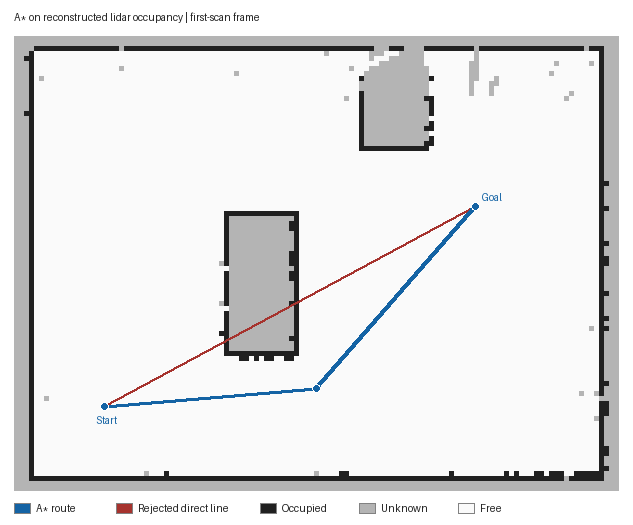

# 재구성한 LiDAR 지도에서의 경로 계획

시드 7의 센서 기록으로 0.07 m 점유 지도를 다시 만들고 첫 스캔 좌표계의 `(0, 0)`에서 `(5.2, 2.8)`까지 A*를 실행했다. 직선이 중앙 장애물을 지나므로 계획기는 `(2.975, 0.245)`를 경유하는 **6.373 m** 경로를 반환했다. 로봇 반경 0.24 m와 여유 0.13 m를 합한 0.370 m를 적용했다.



| 확인 항목 | 시드 7 결과 |
| --- | --- |
| 재구성 지도에서 경로 중심선의 최소 여유 하한 | 0.380 m |
| 시뮬레이터 기준 형상에서 실제 차체 외곽의 최소 여유 | 0.236 m |
| 동일한 시작점과 목표점을 잇는 직선 | 점유 지도에서 거절, 기준 형상에서도 장애물과 교차 |
| 점유 셀 `(2.3, 0.72)`을 목표로 지정 | `NO_PATH` |
| 미관측 셀 `(2.3, 1.4)`을 목표로 지정 | `NO_PATH` |

센서 기록의 69개 키프레임에서 엔코더 오도메트리와 36빔 거리만 읽어 자세와 점유를 재추정했다. 목표와 대조 좌표는 첫 스캔 좌표계에서 지정했다. 계획기는 알려진 지도 실험의 A*를 재사용하고, 재구성 격자의 자유 셀만 허용한다. 미관측·점유 셀과 격자 바깥은 차단한다. 대각선 모서리를 가로지를 수 없으며, 경로를 직선으로 단순화할 때와 최종 반환할 때 모든 선분에서 원형 차체와 여유를 검사한다. 셀을 외접원으로 감싸고 선분 표본 간격의 절반을 더해 연속 구간의 여유 하한을 계산한다. 합성 격자 테스트에서는 양 끝점이 자유 셀인 경우에도 그 사이를 가로막은 미관측 또는 점유 띠를 통과하지 못한다. [계획기](../src/pickloop/slam_navigation.py) · [테스트](../tests/test_slam_navigation.py)

계획이 끝난 뒤 평가기가 시뮬레이터의 시작 자세와 벽·장애물 형상을 읽어, 각 경로 선분과 기준 형상의 최소 거리를 기하학적으로 계산했다. 이 결과의 범위는 운동학 시뮬레이터에서 수집한 단일 기록의 오프라인 지도 재구성과 정적 경로 계획이다. 경로 그림은 계획 결과를 보여 준다. [실험 코드](../scripts/run_slam_navigation.py) · [수치와 경로 좌표](../runs/slam-navigation/summary.json) · [지도 재구성 실험](lidar-slam.md)

## 재현

저장소 루트에서 프로젝트 의존성을 설치한 Python으로 실행한다.

```bash
PYTHONPATH=src OPENBLAS_NUM_THREADS=1 python scripts/run_slam_navigation.py --out-dir /tmp/pickloop-slam-navigation
PYTHONPATH=src python -m pytest tests/test_slam_navigation.py tests/test_lidar_slam.py -q
```
